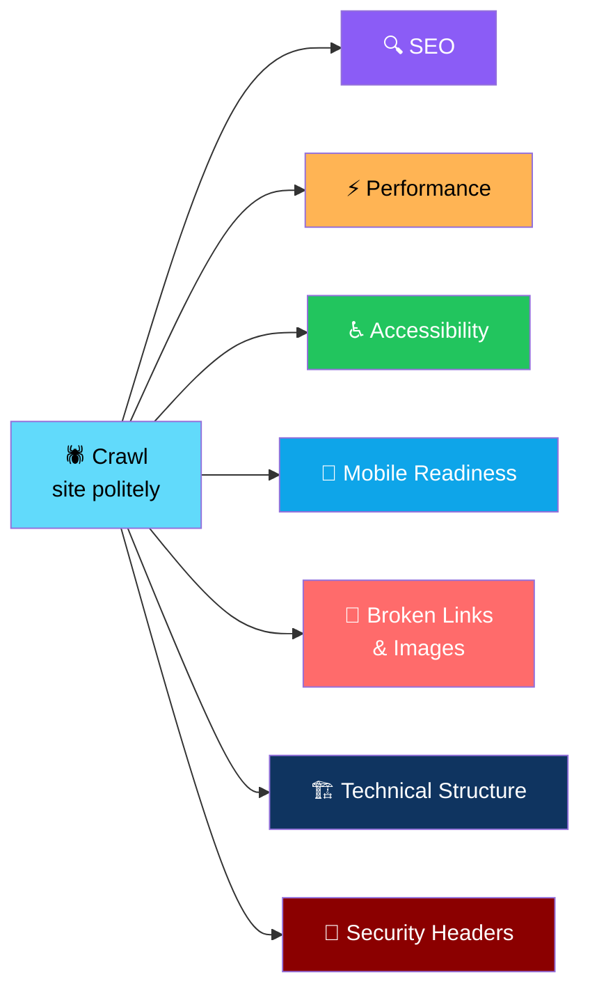
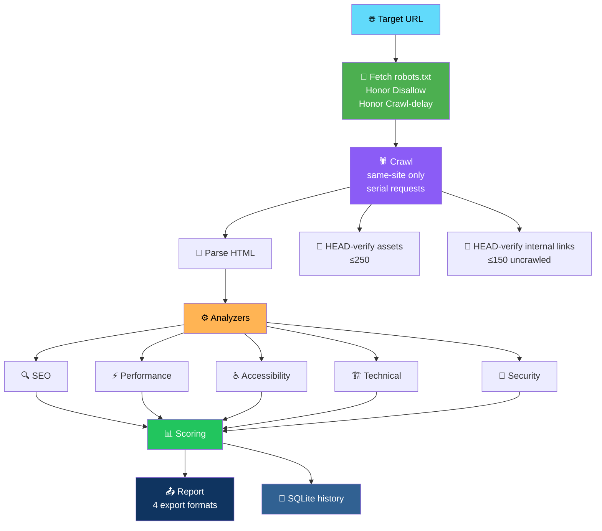
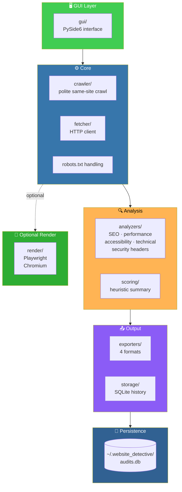

# 🕵️ Website Detective

<div align="center">


**Crawl a website. Get a technical audit.**

*SEO · Performance · Accessibility · Mobile readiness · Broken links · Structure · Security headers*

[🎯 Scope](#-scope) • [🚀 Run From Source](#-run-from-source-python-311) • [🔍 What Is Checked](#-what-is-checked) • [🕷️ Crawl Behavior](#-crawl-behavior) • [🧪 Tests](#-tests)

</div>

---

## 📖 Overview

**Website Detective** is a **desktop tool** that crawls a website *(politely)* and produces a **technical audit**.

### What It Audits



---

## 🎯 Scope

> **Passive review of publicly served pages and headers.**

### ✅ What This Tool Does

- Reviews publicly served **pages and headers**
- Produces a **technical audit** with scores and findings
- Uses **hedged wording** in every finding

### ❌ What This Tool Does NOT Do

- ❌ **Not a penetration test**
- ❌ **Does no exploitation**
- ❌ **Never probes external domains**
- ❌ **Makes no guarantee about search ranking**

### ⚠️ Responsible Use

> **Only audit sites you own or have permission to scan.**
>
> **Scores are a heuristic summary for this tool and are not a prediction of search ranking.**

---

## 🚀 Run From Source (Python 3.11+)

```bash
pip install -r requirements.txt
python main.py
```

### 🔄 Optional — Browser Rendering

**For JavaScript-rendered content:**

```bash
pip install playwright
playwright install chromium
```

Then tick **"Render with browser"** in the app.

> 💡 **Rendered pages give a *measured* request count and an executed-JS DOM.**

> ⚠️ **Browser rendering is excluded from the EXE** to keep it small — **run from source for that feature.**

---

## 🔍 What Is Checked

<div align="center">

| Area | Checks |
|------|--------|
| **🔍 SEO** | Title · meta description · canonical · H1/headings · robots.txt · sitemap · Open Graph · JSON-LD validity · noindex · duplicate titles/descriptions |
| **⚡ Performance** | Response time · HTML size · total weight *(known sizes)* · request count · compression · caching headers · large images/assets · image dimensions |
| **♿ Accessibility** | `html lang` · alt text · heading order · form labels · link/button names · duplicate ids · ARIA references · zoom blocking · inline-style contrast *(indicator only)* |
| **🏗️ Technical** | HTTP status · redirects/chains · broken internal links · broken images/assets · canonical mismatch · viewport |
| **🔐 Security Headers** | HTTPS · HSTS · CSP · X-Content-Type-Options · Referrer-Policy · framing protection · server version disclosure |

</div>

### 📊 The Audit Pipeline



---

## 🕷️ Crawl Behavior

<div align="center">

| Behavior | Implementation |
|----------|---------------|
| **Page limit** | Presets **10 / 25 / 50 / 100** or a custom limit |
| **Same-site only** | **External links are never crawled or probed** |
| **Robots.txt** | Honors `Disallow` and `Crawl-delay` *(capped at 10 s)* |
| **Request rate** | Minimum delay between requests is **configurable** *(default 0.5 s)* |
| **Request order** | **Serial** — no parallel hammering |
| **Page body cap** | **5 MB per page** |
| **Link verification** | At most **150 uncrawled internal links** verified via HEAD |
| **Asset verification** | At most **250 assets** verified via HEAD |

</div>

> 💡 **Website Detective is polite by design.** It's a tool for understanding a site, not for overwhelming one.

---

## 🧪 Tests

```bash
python -m unittest discover -s tests -t .
```

### What's Covered

<div align="center">

| Area | Coverage |
|------|:--------:|
| **Analyzers** | ✅ |
| **robots.txt handling** | ✅ |
| **External-domain exclusion** | ✅ |
| **Page limit** | ✅ |
| **Cancellation** | ✅ |
| **Unreachable hosts** | ✅ |
| **All four export formats** | ✅ |
| **SQLite storage** | ✅ |

</div>

> ✅ **Tests use a local HTTP fixture site, so no internet is needed.**
>
> ⚠️ **The GUI layer is not covered by automated tests.**

---

## 📦 Windows EXE

**Run:**

```bat
build_exe.bat
```

**Output:** `dist\WebsiteDetective\WebsiteDetective.exe`

- PyInstaller, **one-folder build**
- **Browser rendering is excluded** to keep it small

> 💡 **Run from source if you need the browser rendering feature.**

---

## ⚠️ Known Limits

<div align="center">

| Limit | Details |
|-------|---------|
| **JavaScript content** | Without browser rendering, JS-generated content is **not seen** |
| **Weight & request count** | Come from HTML references plus `Content-Length` headers — **they are estimates** |
| **Contrast checking** | Sees **inline styles only** — use a dedicated tool for a full WCAG audit |
| **Findings wording** | Uses **hedged wording** — none claim a guaranteed ranking effect |

</div>

---

## 🏗️ Architecture

### System Overview



### 🗂️ Project Layout

```
website_detective/
├── crawler/          polite same-site crawl
├── analyzers/        SEO · performance · accessibility · technical · security headers
├── fetcher/          HTTP client
├── scoring/          heuristic summary
├── exporters/        four export formats
├── storage/          SQLite history
├── render/           optional Playwright browser rendering
└── gui/              PySide6 interface

tests/                unit tests with a local HTTP fixture site
main.py               entry point
```

**History is stored in:** `~/.website_detective/audits.db`

### Design Principles

<div align="center">

| Principle | Implementation |
|-----------|---------------|
| **🛡️ Passive only** | Reviews publicly served pages and headers — no exploitation, no probing external domains |
| **🤖 Politely by default** | Honors robots.txt, respects Crawl-delay, serial requests, configurable minimum delay |
| **🌐 Same-site only** | External links are **never crawled or probed** |
| **📊 Heuristic, not predictive** | Scores summarize this tool's findings — they never predict search ranking |
| **⚠️ Hedged wording** | Findings describe what was observed, not what it means for rankings |
| **🎨 Rendered mode is opt-in** | Playwright adds measured request counts and executed-JS DOM when you need it |
| **🧪 Tested without the internet** | Tests run against a local HTTP fixture site — no live network needed |
| **💾 History without a backend** | SQLite under `~/.website_detective/` — nothing sent anywhere |

</div>

---

## 🗺️ Roadmap

### ✅ Current

- [x] Polite same-site crawl with configurable page limits
- [x] Honors robots.txt `Disallow` and `Crawl-delay`
- [x] Configurable minimum delay between requests
- [x] Serial requests — no parallel hammering
- [x] 5 MB page body cap
- [x] Same-site only — external links never crawled or probed
- [x] HEAD verification for up to 150 internal links and 250 assets
- [x] SEO analysis — title, meta description, canonical, headings, robots.txt, sitemap, Open Graph, JSON-LD, noindex, duplicates
- [x] Performance analysis — response time, HTML size, weight estimate, request count, compression, caching, large assets
- [x] Accessibility analysis — lang, alt text, heading order, labels, link/button names, duplicate ids, ARIA, zoom blocking, contrast indicator
- [x] Technical analysis — status, redirects, broken links and images, canonical mismatch, viewport
- [x] Security headers analysis — HTTPS, HSTS, CSP, X-Content-Type-Options, Referrer-Policy, framing, version disclosure
- [x] Optional browser rendering via Playwright
- [x] Four export formats
- [x] SQLite history
- [x] Cancellation support
- [x] PyInstaller one-folder build
- [x] Unit test suite with local HTTP fixture

### 🔜 Future Ideas

- [ ] **Scheduled audits** — track changes over time
- [ ] **Diff view** — compare two audits of the same site
- [ ] **CI integration** — audit on deploy
- [ ] **Additional checks** — structured data validation depth
- [ ] **Crawl configuration UI** — per-path rules
- [ ] **Sitemap-driven crawling** — start from sitemap.xml
- [ ] **Redirect chain visualization** — graph view
- [ ] **Multi-page comparison** — which templates need work
- [ ] **Localization checks** — hreflang validation
- [ ] **Print-friendly reports**

---

## 🤝 Contributing

Contributions are welcome. Please:

1. Fork the repository
2. **Keep it passive** — no exploitation, no active probing
3. **Keep it polite** — respect robots.txt and rate limits
4. **Never crawl external domains** — same-site only
5. **Keep wording hedged** — findings describe observations, not guarantees
6. **Add tests using the local fixture site** — no live network in the test suite
7. Submit a Pull Request

### Guidelines

- **Never bypass robots.txt** — it's not optional
- **Never remove the request delay** — this tool is a guest on someone's site
- **Never probe external domains** — even for assets
- **Never promise ranking outcomes** — the scores are heuristic
- **Never ship the tool without the fixture-based tests passing**
- **Never include browser rendering in the EXE** unless the size cost is acceptable

---

## 📜 License

MIT — see [LICENSE](LICENSE) for details.

---

## 🙏 Acknowledgments

- **Playwright** — for optional rendering without a full browser stack
- **The web standards community** — for publicly documented best practices this tool checks against
- **Every site owner who's ever wondered why their pages are slow** — this is for you

---

<div align="center">

### 🕵️ CRAWL. AUDIT. REPORT. FIX.

**Crawl a website. Get a technical audit.**

**Passive only. Polite by default. Same-site only.**

<br>

> ⚠️ **Only audit sites you own or have permission to scan.**

<br>

⭐ If Website Detective helped you, consider giving it a star.

<br>

[⬆ Back to Top](#️-website-detective-)

</div>
